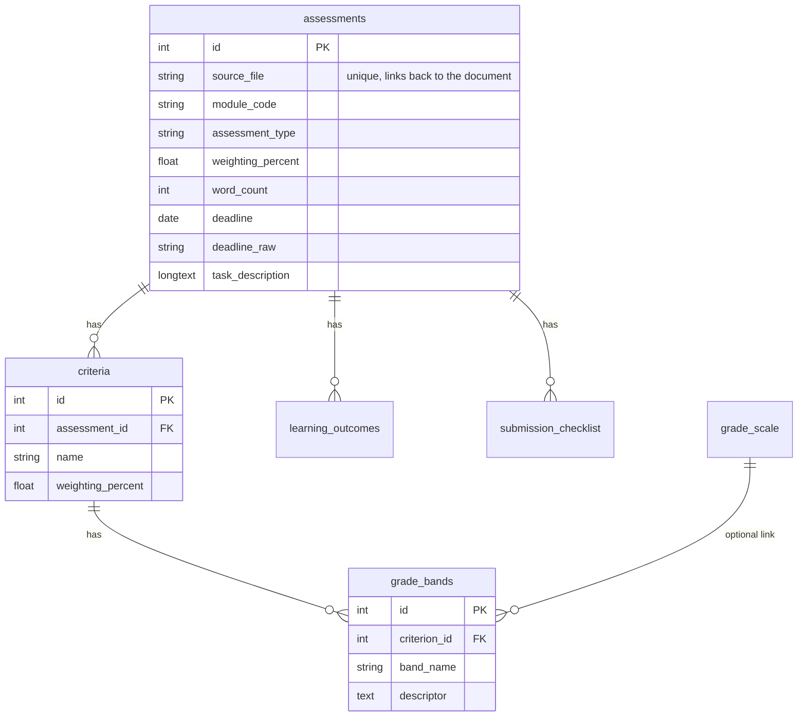

# Centralised University Assessment Database

A prototype built during my **Data Analyst – Digital Repository internship at the University of Roehampton**.

It takes assessment briefs (PDF and Word), extracts their information into one validated, structured **MySQL** database, and includes a chatbot on top as a first example of what that database makes possible.

**Status:** prototype for exploration, not a production university system.

**If you want to build on this:** Section 3 takes you from a fresh clone to a running system without building anything from scratch, and Section 4 lists what already exists so you can start on what comes next.

| | |
|---|---|
| [1. The research question](#1-the-research-question) | What this project is trying to find out |
| [2. What I have created](#2-what-i-have-created) | The pipeline, the database design and the code |
| [3. Run it without rebuilding it](#3-run-it-without-rebuilding-it) | Set-up, step by step |
| [4. How this saves you time](#4-how-this-saves-you-time-and-what-to-build-on-top) | What is already solved, and ideas to build on top |

---

## 1. The research question

> **Can bringing assessment information from across the university into one centralised, structured database improve how students, lecturers and administrators access it, and what could be built on top of it?**

### Why assessment data?

Assessment information is currently spread across separate documents and modules. That makes it hard to get an overview of things such as assessment types, deadlines, weightings and requirements. It is also a well-defined slice of university data, which makes it a good place to test the wider idea of a centralised repository.

### The questions this prototype helps explore

| Question | What the prototype provides | Where it stands |
|---|---|---|
| Can assessment information from different documents be brought into one structured database? | Extraction pipeline, validated schema, MySQL database | Tested on a small set of briefs. Other departments are not tested yet |
| Can staff and students get an overview across modules (deadlines, weightings, types, clashes)? | SQL queries in [`database/example_queries.sql`](database/example_queries.sql) | Works on the data ingested so far |
| Can the data be used to spot gaps or inconsistencies in assessment briefs? | "Missing information" queries | Basic version only |
| Can students and lecturers get answers and feedback from the data? | A chatbot with question answering and draft feedback | Working prototype |
| Could educational analytics identify where students struggle, to improve the curriculum? | Not covered. Needs student performance data, permissions and data protection work | Open |
| Is a university-built system cheaper and more secure than buying one in? | Not something the prototype can measure | Open. The prototype currently calls an external AI service (see [Data protection](#data-protection-and-limitations)) |

---

## 2. What I have created

### The pipeline

```text
Assessment briefs (PDF / DOCX)
            ↓
   Text extraction (PyMuPDF, python-docx)
            ↓
   Gemini fills in a Pydantic schema   ← validated: wrong types and missing fields are caught here
            ↓
   MySQL relational database           ← the central, reusable layer
            ↓
 ┌──────────┼───────────────┬──────────────┐
 ↓          ↓               ↓              ↓
SQL      Chatbot        Draft feedback   Your idea
queries  (Q&A)          for students     goes here
```

The key design choice is to keep the data **separate from any application that uses it**. Once a brief is in the database, nothing needs to read the original document again.

### The database



| Table | What it holds |
|---|---|
| `assessments` | One row per brief: programme, module code and title, level, assessment type, weighting, word count or duration, deadline, feedback date, submission format, and the long text sections (task, success guidance, layout and style, referencing, employability, use of AI, ethics) |
| `criteria` | The marking criteria for each assessment, with weightings |
| `grade_bands` | What each grade band looks like for each criterion (the rubric grid) |
| `grade_scale` | The university grade scale (band names, mark ranges, undergraduate and postgraduate outcomes). Reference data, filled in by the set-up script |
| `learning_outcomes` | One row per learning outcome |
| `submission_checklist` | One row per checklist item |

The full definition is in [`database/schema.sql`](database/schema.sql).

**Design decisions worth knowing about**

- **Relational for facts, search only for free text.** Deadlines, weightings and criteria are answered by SQL, which is exact. Only the long text sections are embedded and searched.
- **Lists get their own tables.** Learning outcomes, checklists and criteria are separate rows, so they can be counted, compared and checked one by one.
- **Wording and dates are both kept.** Briefs often say "Week 10" instead of a date, so `deadline` holds the parsed date (or `NULL`) and `deadline_raw` holds exactly what the brief said.
- **Nothing is guessed.** If a brief does not state something, the field is `NULL`, not a plausible invention.
- **Every row is traceable.** `source_file` links each record back to the document it came from.

### The code (`src/`)

| File | What it does |
|---|---|
| `schema.py` | The Pydantic model that defines what is extracted. **Change this to change what is captured** |
| `ingest.py` | The pipeline: reads PDFs and Word files, extracts the data with Gemini, validates it, and saves it to MySQL. It first checks that the database matches `schema.py` and prints the SQL to fix any difference |
| `db.py` | **The read layer.** Small functions that return the stored data. This is where to start if you are building something on top |
| `llm.py` | The only file that calls Gemini, with retries, an optional fallback model and an on-disk cache |
| `chunking.py` / `embedding.py` | Splits the long text sections into chunks and searches them with a local embedding model (no API needed), filtered to one assessment |
| `qa.py` | Question answering: facts from SQL, relevant text from search |
| `student_feedback.py` | Feedback on a student's draft against the stored marking criteria and grade bands |
| `app.py` | The Streamlit interface |

```text
edu-rag-prototype/
├── README.md
├── .env.example              ← copy to .env and fill in
├── requirements.txt
├── database/
│   ├── schema.sql            ← creates the whole database
│   └── example_queries.sql   ← ready-made questions to ask it
├── briefs/                   ← your assessment documents (not committed)
└── src/
    ├── schema.py   ingest.py   db.py   llm.py
    ├── chunking.py   embedding.py   qa.py   student_feedback.py
    └── app.py
```

---

## 3. Run it without rebuilding it

You do **not** need to design the database or write the extraction code. The database is created by one script, and the pipeline fills it from your own documents.

### What you need

- **Python 3.12 to 3.14** (a stable release, not an alpha or pre-release version)
- **MySQL 8** and, optionally, MySQL Workbench
- A **Google Gemini API key**, used for extraction and for the chatbot. The database itself does not need it
- Assessment briefs you are **authorised to use** (`.pdf` or `.docx`)

### Steps

**1. Clone the repository and open a terminal in it**

```bash
git clone <repository-url>
cd edu-rag-prototype
```

**2. Create a virtual environment and install the dependencies**

Windows (PowerShell):

```powershell
python -m venv .venv
.venv\Scripts\Activate.ps1
pip install -r requirements.txt
```

macOS / Linux:

```bash
python -m venv .venv
source .venv/bin/activate
pip install -r requirements.txt
```

**3. Add your settings**

Copy `.env.example` to `.env` and fill in your Gemini key and MySQL password. The `.env` file is private, so never commit it.

**4. Create the database (the step that saves you from building it)**

```bash
mysql -u root -p < database/schema.sql
```

Or open `database/schema.sql` in MySQL Workbench (File, Open SQL Script) and run it. This creates the `rag_system` database, every table, and the grade scale.

**5. Check the connection**

```bash
python src/db.py
```

It should report `0 assessment(s) in the database`, which means it connected and is ready for data.

**6. Add your assessment briefs**

Put your documents in a `briefs/` folder, then run:

```bash
python src/ingest.py briefs
```

For each file it prints what it saved, for example `saved assessment 3: 4 learning outcomes, 5 criteria`. If a file fails, the others still finish, and you can run the same command again to retry. Files that finished are cached, so they do not call Gemini a second time.

**7. Explore the data**

Run the queries in `database/example_queries.sql`, for example:

```sql
-- A centralised assessment calendar
SELECT module_code, assessment_type, COALESCE(deadline_raw, deadline) AS deadline, weighting_percent
FROM assessments
ORDER BY deadline IS NULL, deadline;
```

or read the data from Python:

```python
import db

for a in db.list_assessments():
    facts = db.get_assessment(a["id"])
    print(facts["module_code"], facts["assessment_type"], facts["deadline_raw"] or facts["deadline"])
```

**8. Run the chatbot (optional)**

```bash
python -m streamlit run src/app.py
```

The first run downloads a small embedding model (about 90 MB), after which search works offline. After adding new briefs, press **Rebuild search index** in the sidebar.

### Using it with a different set of documents or fields

Edit `src/schema.py` to change what is extracted, then run `python src/ingest.py <folder>`. If the database does not match the schema yet, the script stops before saving anything and prints the exact SQL needed, for example:

```text
- No column 'credits' in the assessments table. Add it with:
      ALTER TABLE assessments ADD COLUMN credits INT;
```

### If something goes wrong

| Problem | What it usually means |
|---|---|
| `KeyError: 'MYSQL_PASSWORD'` or a missing API key | `.env` is missing or is not in the project folder |
| `The database doesn't match schema.py yet` | Run the SQL the message prints in MySQL, then try again |
| Gemini `503` or "busy" | Temporary overload. The script retries on its own. If files still fail, run the same command again |
| A brief saves with 0 criteria or outcomes | The extraction missed them. Check that brief's text, as rubric tables in some layouts do not extract cleanly |
| Packages fail to install or Streamlit crashes at start-up | Check `python --version`. Pre-release Python versions break some libraries |

---

## 4. How this saves you time (and what to build on top)

### What is already solved

If you wanted to explore this idea from scratch, you would first have to work out all of the following. Here it already exists:

| You would otherwise have to... | Already done here |
|---|---|
| Design a database for assessment information | `schema.sql`: tables, relationships and indexes, including the rubric grid and grade scale |
| Decide what an "assessment" is as data | `schema.py`: a validated model, with descriptions that guide the extraction |
| Read PDFs and Word files, including tables | `ingest.py`, with Word tables read in order |
| Make AI extraction reliable | Validation, retries, a fallback model, caching, and a check that the database matches the schema |
| Write the SQL to compare assessments across modules | `example_queries.sql` |
| Build search over the long text | Local embeddings, filtered per assessment, with no API cost |
| Build something usable | A chatbot and a draft-feedback tool, as working examples |

You can skip straight to the question you actually want to investigate.

### Ideas to build on top

Everything reads through `src/db.py` or standard SQL, so a new application never needs to touch the original documents.

| Idea | A starting point |
|---|---|
| **Student assessment calendar** (all deadlines in one place) | Query 7 in `example_queries.sql`, plus any calendar or dashboard library |
| **Deadline clustering and workload view** | Query 6 (deadlines close together), grouped by programme |
| **Staff review of assessment briefs** (consistency, missing information) | Queries 4, 5 and 5b |
| **Comparing assessment design across modules** | `GROUP BY` assessment type, weighting or word count |
| **Dashboards** | MySQL connects to standard reporting tools such as Power BI or Tableau |
| **Educational analytics** | Join `assessments` to your own performance or feedback tables on `module_code`. This needs the right permissions first |
| **Better AI features** | Replace or extend `qa.py` and `student_feedback.py`. They already take their data from `db.py` |
| **Other document types** (module outlines, handbooks) | Add a model to `schema.py` and tables to `schema.sql`, then reuse `ingest.py` |

---

## Data protection and limitations

**Before you use this**

- Only use documents you are **authorised to access**.
- **The AI calls send text to an external service.** Extraction sends brief text to the Gemini API, and the chatbot and draft-feedback tool send questions and student drafts to it. Do not use real student work until the university has approved a suitable setup, such as a paid or institutional account, or a model hosted by the university.
- Keep passwords and API keys out of the repository. Make sure `.env`, `briefs/`, `src/gemini_cache/`, `src/index/` and `.venv/` are listed in `.gitignore`.
- Avoid storing student information unnecessarily, and get the proper permissions before working with student-level data.

**Current limitations**

- **Small sample.** Tested on a small set of briefs from one department. Other layouts and departments may need changes to the schema or prompts.
- **Layout differences.** Rubric tables and unusual layouts can extract imperfectly, so spot-check results against the original documents.
- **Images are not read.** Anything in a brief that exists only as an image, such as an example or diagram, is not captured.
- **Missing information stays missing.** Not every brief contains every field, so the database is only as complete as its source documents.
- **Not production-ready.** A real system would need authentication and access control, data governance, security review, scalability, user testing, integration with existing systems (such as Moodle) and institutional approval.
- **AI output needs checking.** Chatbot answers and draft feedback can be wrong and are not a substitute for a lecturer.

---

## Context

This project was developed as part of my **Data Analyst – Digital Repository internship at the University of Roehampton**, which looks at how university materials could be organised and made easier to access within the Computing Department. My work focused on assessment information: extracting it from existing documents and storing it in a structured, reusable form.